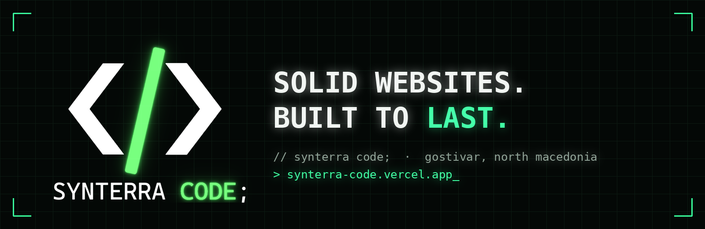
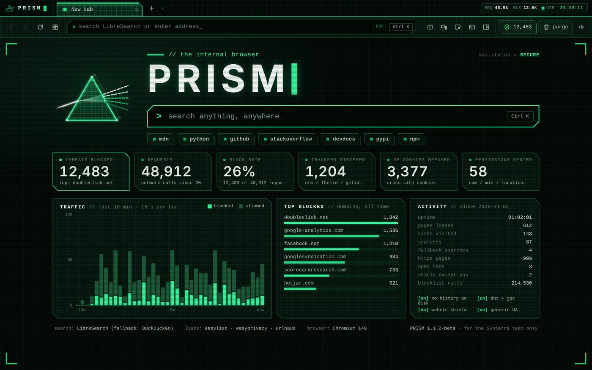
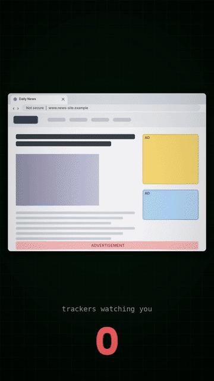
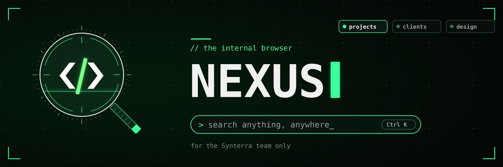
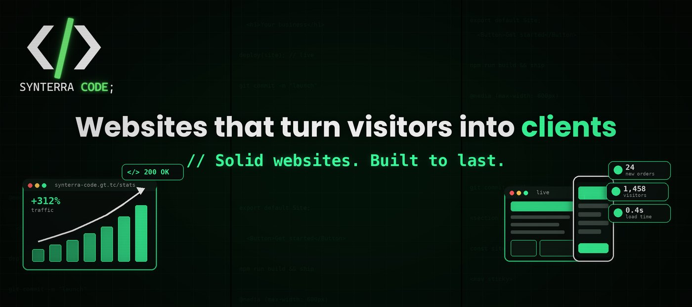
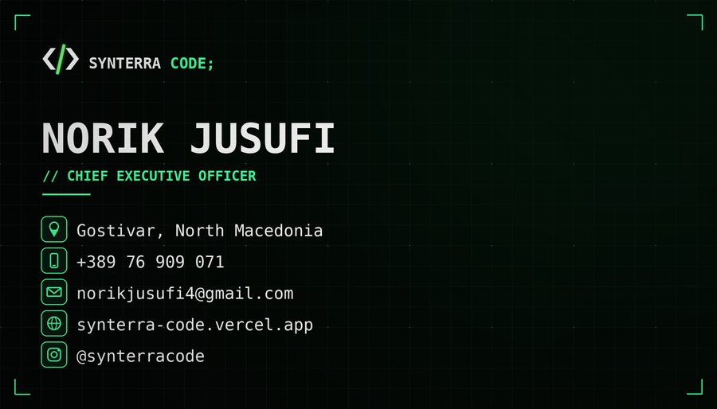
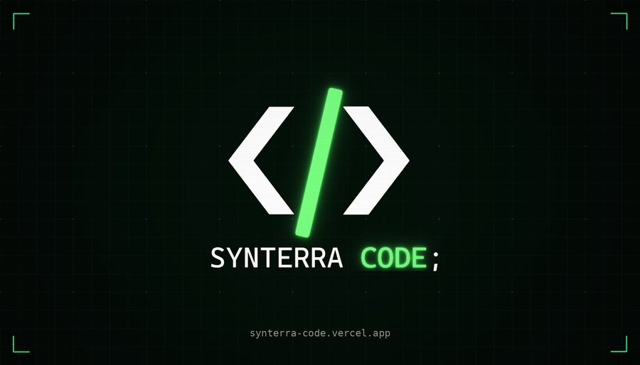

# Hi, I'm Norik 👋
**CEO and founder of [Synterra Code;](https://synterra-code.vercel.app)**, a website-building studio in Gostivar, North Macedonia.

---

## `> about`

We build custom websites for businesses in North Macedonia and beyond: online stores, marketing sites, restaurant menus and whatever else you can imagine. Everything is built by hand, so it loads fast and lasts.

## `> portfolio`

### Prism: a privacy-first, open-source browser
Built for the Synterra team. Blocks ads and trackers, keeps no history on disk, and has developer tools inside the window. Runs from a Windows installer or straight from Python.

  

- Ad and tracker blocking with a live traffic chart
- DNS over HTTPS and WebRTC leak protection
- Containers, split view, responsive preview, API tester and terminal
- Trust score for every site

**[→ View Prism on GitHub](https://github.com/norik-jusufi/Prism)**

  

Interface shown with sample numbers.

### Nexus: a search-first identity
Logo and banner for the team's internal search tool.

### Brand and social
One look across everything we make: black, neon green, mono type and a grid.

  
  

## `> stack`

## `> contact`

Need a website that performs? **[synterra-code.vercel.app](https://synterra-code.vercel.app)**

// Synterra Code; · Gostivar, North Macedonia

